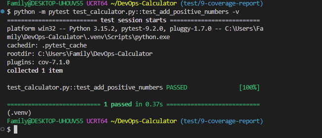
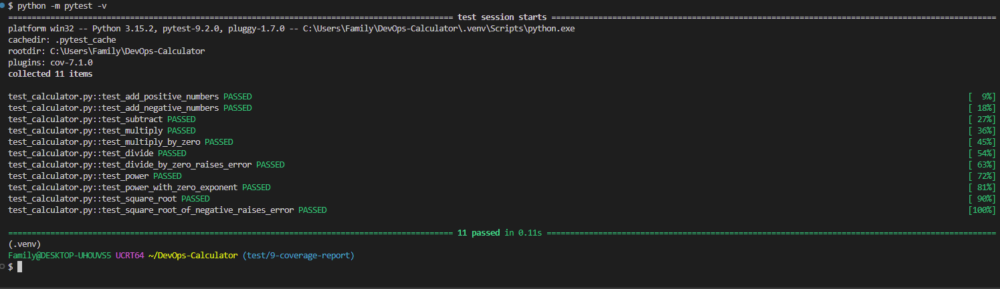
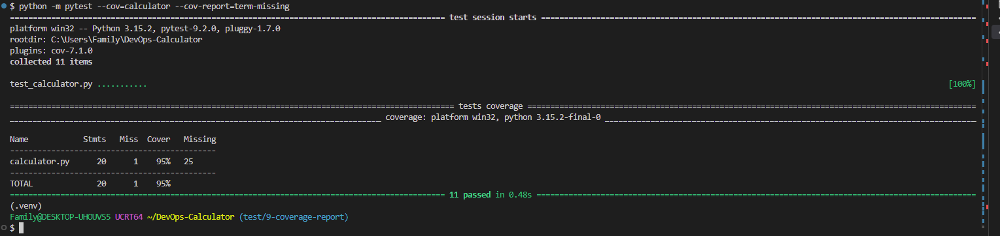

# DevOps-Calculator

A small Python Calculator class built to demonstrate core DevOps practices: version control with a branching strategy, agile issue tracking in a GitHub Project, and automated unit testing with code coverage.

## Project structure

devops-calculator/
├── calculator.py        # the Calculator class (add, subtract, multiply, divide, power, square_root)
├── test_calculator.py   # pytest unit test suite for the Calculator class
├── requirements.txt     # pytest and pytest-cov
└── README.md

## Getting started

git clone https://github.com/<your-username>/devops-calculator.git
cd devops-calculator
python -m venv .venv
# Windows:  .venv\Scripts\activate      macOS/Linux:  source .venv/bin/activate
pip install -r requirements.txt

## Running the tests

#run a single unit test on its own
pytest test_calculator.py::test_add_positive_numbers -v

#run the whole test suite
pytest -v

#run the suite and measure coverage
pytest --cov=calculator --cov-report=term-missing

#optional: browsable HTML coverage report (open htmlcov/index.html)
pytest --cov=calculator --cov-report=html

# Branching strategy: GitHub Flow

This project uses GitHub Flow, a lightweight strategy that suits a small team (or a solo developer) practising continuous delivery.

Why GitHub Flow and not GitFlow? GitFlow adds long-lived develop, release/* and hotfix/* branches, which only pay off when you ship scheduled releases and support several versions at once. This project has one version and one deployable state, so GitHub Flow's single long-lived branch keeps things simple

# Rules

1. main is always stable and deployable. Nobody commits directly to it.
2. Every piece of work starts from an issue in the GitHub Project.
3. Create a short-lived branch from main for that issue.
4. Commit small and often, with clear messages.
5. Open a pull request (PR) into main and link the issue with Closes #<number>.
6. Check that the tests pass, review the PR, then merge.
7. Delete the branch after merging.

# Branch naming

Prefix              Use                                 Example

feature/       new functionality                 feature/5-divide-method
bugfix/         fixing a defect                  bugfix/7-sqrt-negative-input
test/        adding or changing tests            test/8-calculator-test-suite
docs/          documentation only                  docs/10-branching-readme

Format: <prefix>/<issue-number>-<short-description>

# Commit messages
Short, present tense, and referencing the issue, for example: Add divide method with zero check (#5)

# Project management
Work is tracked in the GitHub Project DevOps Calculator Board with:

Milestones: Project Setup, Core Features, Testing and Documentation

Labels: feature, bug, test, documentation, chore

Sprints: one-week iterations (Sprint 1 to 3)

Issues: written as user stories following the INVEST checklist, each with acceptance criteria, a Definition of Ready (DoR) and a Definition of Done (DoD)

# Test evidence

Screenshots (stored in /screenshots):

A single unit test run on its own
The full test suite passing
The coverage report

# Other testing tools (out of scope)

Selenium automates browser UI testing, which would apply if this calculator had a web front end.

Postman tests HTTP APIs, which would apply if the calculator were exposed as an API.

## Test evidence

**Coverage:** 100% of `calculator.py` with 11 tests.

